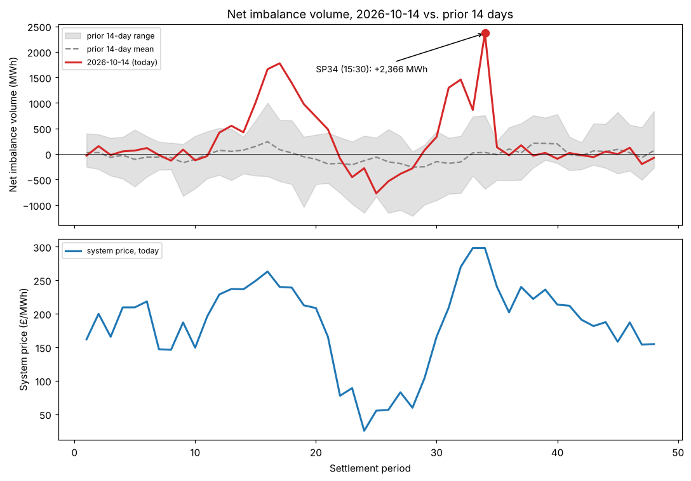

## Imbalance volume spike 2026-10-14

Today's (2026-10-14) net imbalance volume hit **+2,366 MWh at SP34 (15:30-16:00)** —
more than double the next-highest day's peak in the prior 14 days (1,213 MWh on 10-05), and the
day's mean |NIV| (273) is also the highest in that window. The spike coincides with the day's peak
system price (£298/MWh), consistent with a genuine system-wide shortage in the afternoon rather than
a data artifact (price and volume both leaning the same direction, and the shape across SP30-34 builds
rather than spiking from one bad reading).

Not urgent — this doesn't point to a bug in our pipeline, and shadow P&L for today (£98.5k) was
unremarkable (within 1 std of the 30-day mean). Flagging because a system-wide imbalance event this size,
if it recurs, is exactly the kind of tail event our cost-aware backtest numbers (BRIEFING.md 10/10d) should
be checked against — worth keeping in mind when validating BM-side assumptions.

---

