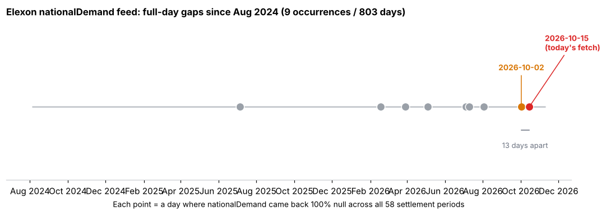

## nationalDemand feed gap recurred — 2026-10-15

**What happened:** Today's fetch for 2026-10-15 shows `data/demand_2026-10-15.csv`'s
`nationalDemand` column 100% empty (0/58 settlement periods), identical in shape to the
2026-10-02 gap flagged in `data/explorations/2026-10-03/note.md`. `transmissionSystemDemand`
and the wind/solar feed were unaffected, so this is specific to Elexon's `nationalDemand`
series, not a broader outage.

**Consequence, as designed:** `shadow.py`'s documented fallback (BRIEFING.md section 17)
kicked in again — 2026-10-15's `da_basis` is `mean_7`, not `reg_demand`. Shadow net P&L for
the day (£57,286) sits on the weaker forecast method and isn't directly comparable to the
surrounding `reg_demand` days (per BRIEFING.md 10/10b-c, `reg_demand` beats `mean_7` by
roughly +7-9% in cost-aware capture).

**Why flag it again:** the 2026-10-03 note treated 2026-10-02 as a possible one-off and said
it would be "worth a one-day watch." It didn't recur the next day, but it has now recurred
13 days later — the 9th such gap across the full 803-day history (Aug 2024 to present; prior
gaps: 2025-07-05, 2026-02-17, 2026-03-29, 2026-05-04, 2026-07-05, 2026-07-10, 2026-08-03,
2026-10-02). The gap-to-gap spacing is irregular (5 to 227 days) — this isn't evidence of an
accelerating problem, just confirmation it's a real, recurring upstream Elexon quirk rather
than a single incident.

**Not urgent:** the fallback is working exactly as designed, no trades (real or shadow) were
lost, and this is already documented behaviour. Flagging only because it's now happened twice
in ~2 weeks after 16 clean weeks, which is worth keeping on the radar — if it starts recurring
weekly rather than every few weeks to months, that would be worth a closer look at whether it's
a specific publication-time issue on Elexon's side.

---
