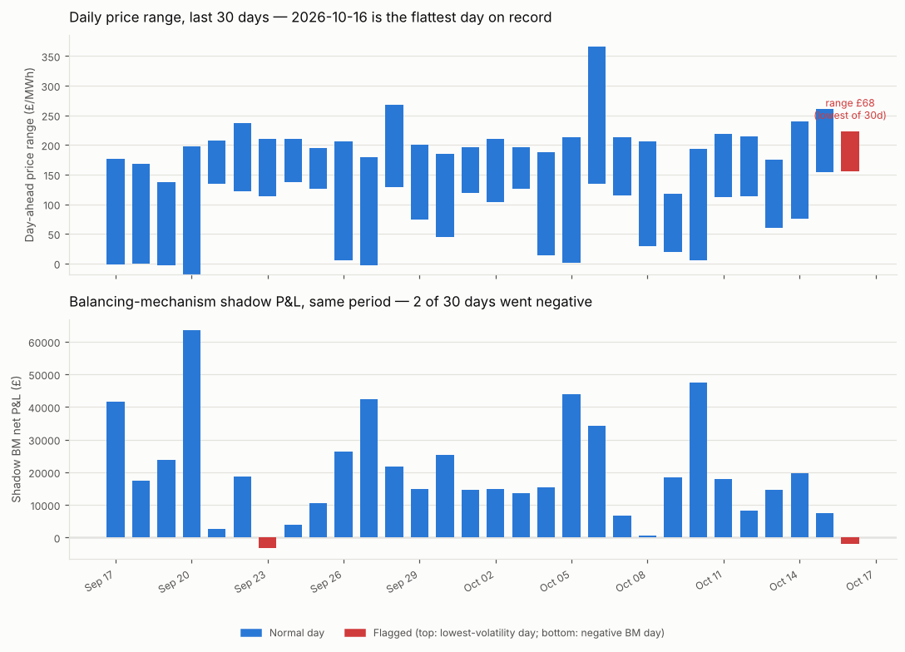

## Flattest price day on record; one of two negative-BM days in 30

**What stood out:** 2026-10-16 had the lowest day-ahead price volatility of the last 30 days — a
£67.56 min-max range and £17.97 std dev, both the smallest in the window (previous 30-day low was
£69.07 range / £18.46 std, on 2026-10-03), despite a still-elevated mean price (£187/MWh). Flat prices
mean less spread for the optimiser to arbitrage.

It also has the lowest total shadow revenue (£55,295) and lowest total shadow cost (£16,996) of the
window by a wide margin (next-lowest revenue was £97,851, on 2026-10-09), and a negative shadow
balancing-mechanism net P&L (bm_net = -£1,941).

Worth noting: 2026-10-16 is NOT the only negative-BM day in the window — 2026-09-23 also went negative
(bm_net = -£3,286, actually more negative than 2026-10-16), and that day was unremarkable on volatility
(std £22.62, mid-pack for the 30-day window). So "flat price → negative BM" isn't a clean one-to-one
rule here; 2026-10-16 is best read as two separate, only loosely-related observations: (1) the single
flattest price day on record in this log, and (2) one of two negative-BM days in 30, with overall P&L
still comfortably positive (net_pnl £38,299, within the normal day-to-day range).

**Urgency:** low. Nothing broken — all 48 settlement periods present as usual, no data gap. Flagging
because it's a new volatility-compression low, which is useful context for the cost-aware vs.
perfect-foresight caveats in BRIEFING.md §10/10d, not because anything needs fixing.

---

