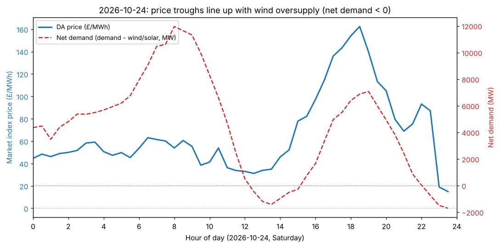

## 2026-10-24 price collapse: wind oversupply drives negative net demand

**What stood out:** 2026-10-24 (Saturday) had by far the lowest day-ahead prices of the last 14 days —
mean £66.78/MWh vs a £125-193/MWh range on every other day in the window, with a day minimum of £14.89/MWh.

**Why:** wind generation ran very high (21.4 GW average, up from 13-16 GW on the preceding few days) on a
weekend day with typically lower demand. Settlement-period detail shows net demand (national demand minus
wind+solar) actually went **negative** during two windows — midday (periods ~25-30, roughly 12:00-15:00) and
late evening (periods ~46-48, roughly 23:00-24:00) — meaning renewable output exceeded demand outright. Prices
in those windows fell to £14.89-£53/MWh, well below the typical £100+ floor seen on other days.

**Is it urgent / a data problem?** No — this is a normal GB market mechanism (high wind + weekend demand
trough), not a fetch or parsing issue; the within-day price/net-demand relationship is clean and consistent
with how the DA market is expected to behave. Worth a note rather than a chart alone because the optimiser's
shadow P&L on the same day was actually one of the strongest in the window (£70,753 net, vs a recent average
in the £45-60k range) — exactly what you'd want: the dispatch model took advantage of a genuine, large intraday
price spread rather than being thrown off by it. No action needed; flagging for visibility only.

---

