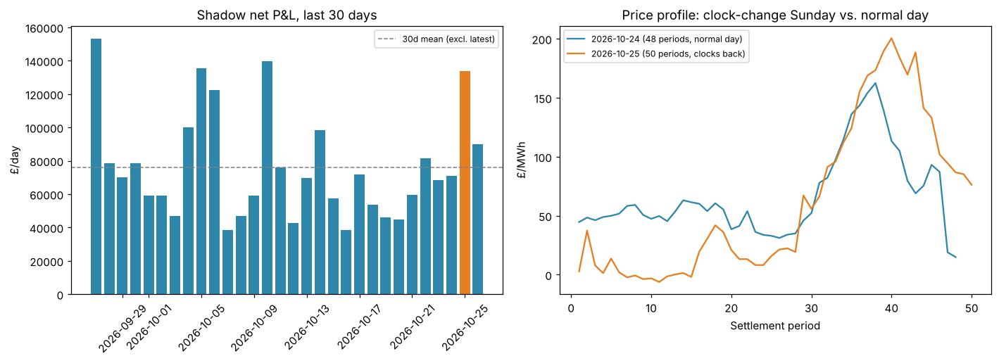

## DST clock-change day (2026-10-25) ran 50 settlement periods, inflating raw shadow P&L

**What:** 2026-10-25 (the last Sunday of October — UK clocks went back, ending BST) had **50 settlement periods instead of the usual 48**, because that calendar day actually spans 25 hours. Shadow P&L that day was £133,899, about 1.8 standard deviations above the trailing-30-day mean (£75,900 ± £32,600) — the second-highest day in the window.

**Why it matters:** this isn't a data quality bug or a genuine demand/price anomaly — it's a mechanical artifact of the extra half-hour periods (2 extra dispatch opportunities that day). Anyone looking at `shadow_pnl.csv` later and treating 2026-10-25 as a normal 48-period trading day (e.g. computing an average £/period, or flagging it as an outlier strategy day) will be misled unless they account for the extra periods. The clocks going forward in spring (23-hour day, 46 periods) will produce the mirror-image effect — a mechanically low-looking day.

**Urgency:** not urgent, no action needed. Flagging for the record so this doesn't get misread in future forecast/P&L analysis. Reflected in today's (2026-10-26, back to a normal 48-period amber day, £89,900) numbers being unremarkable by comparison.

---

